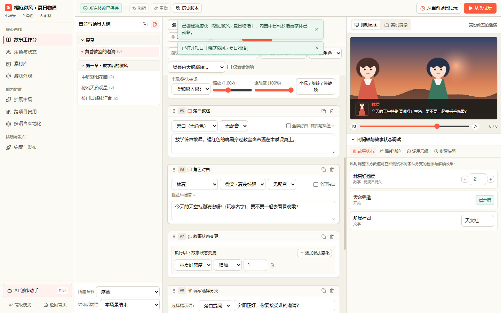
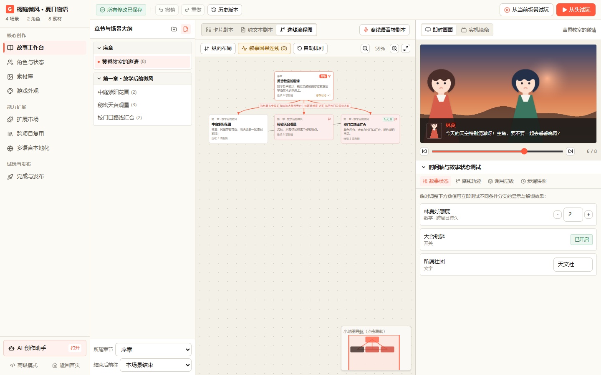
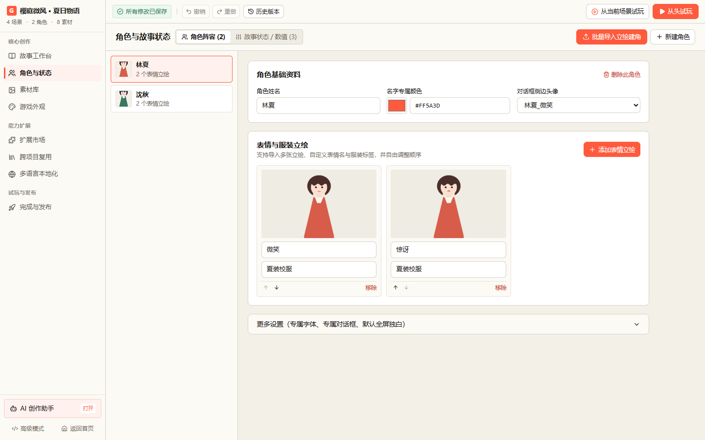
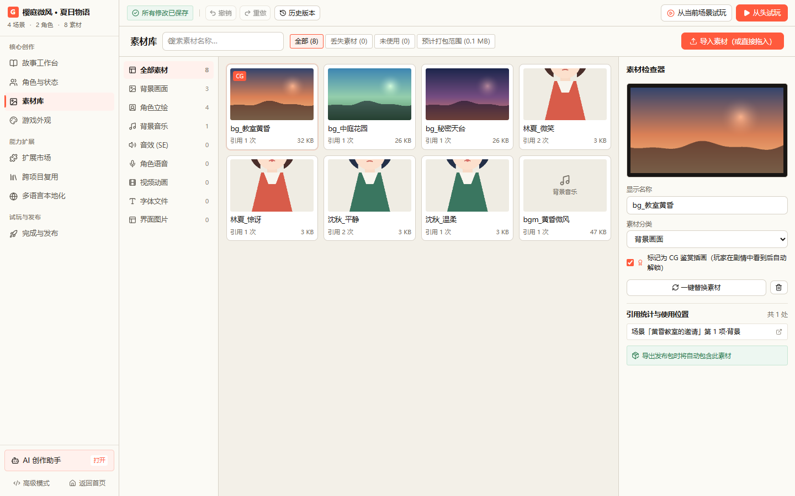
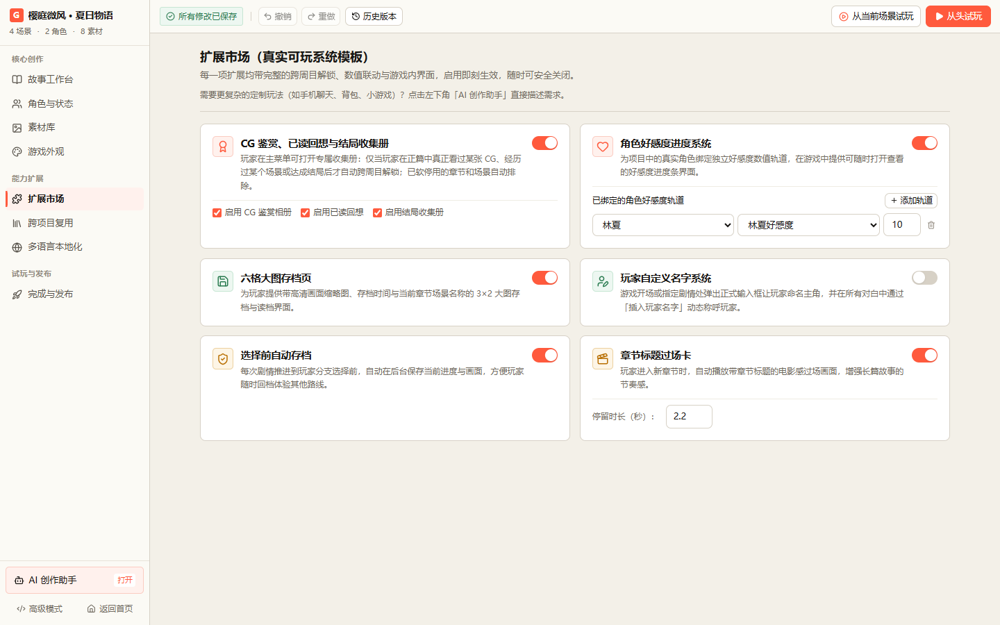
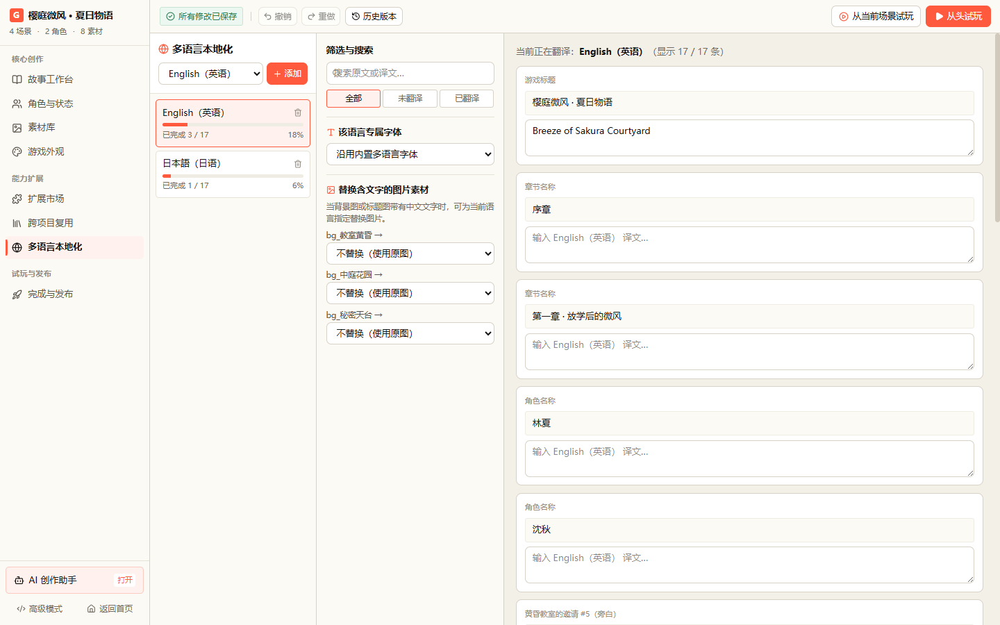
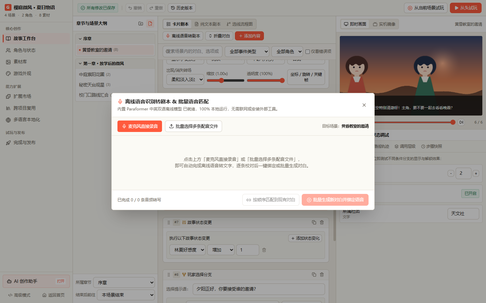
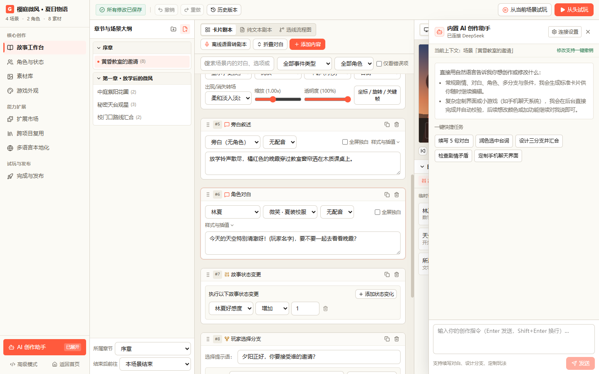
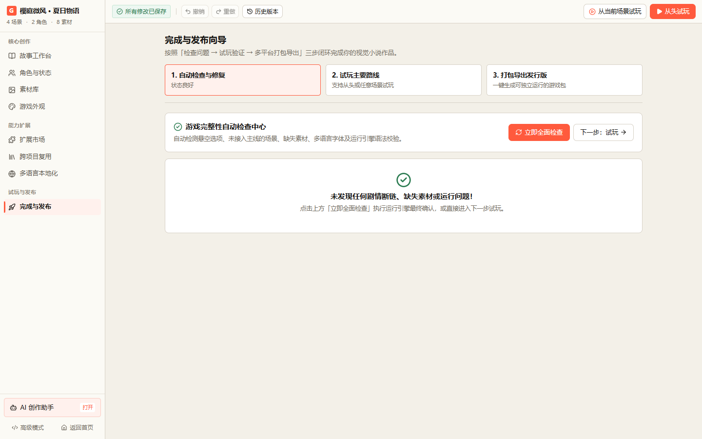
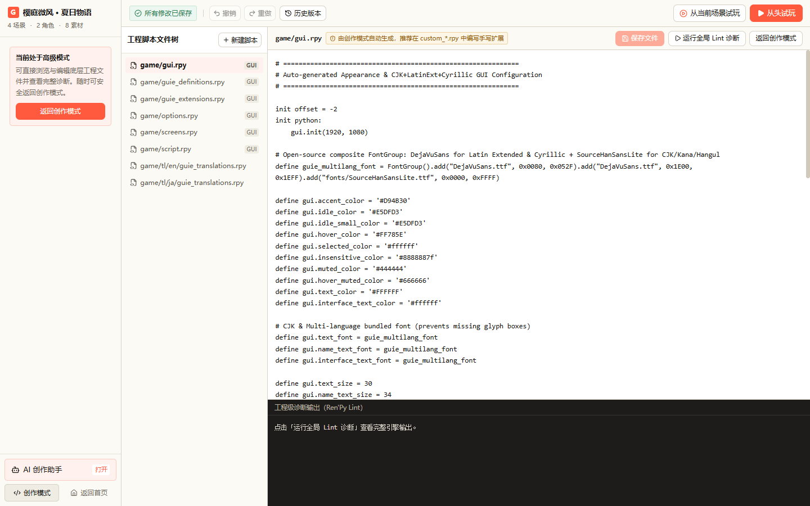

# GUIE Studio · GUIE 视觉小说创作工坊

> **Visual, zero-code desktop studio for building Ren'Py visual novels — with live preview, bidirectional timeline debugging, offline voice-to-script, and an optional built-in AI assistant.**
>
> **基于 Ren'Py 的零代码视觉小说桌面创作工坊 —— 所见即所得即时预览、双向时间轴调试、离线语音转剧本、内置 AI 助手，一键导出独立可玩游戏。**

[English](#english) · [简体中文](#简体中文)

---

<a id="english"></a>

## English

### Why I Built GUIE

I built **GUIE Studio** because writing a visual novel shouldn't require learning a scripting language, configuring SDK paths, hunting down missing CJK fonts, or restarting the game engine every time you tweak a line of dialogue.

GUIE runs on **Ren'Py 8.5.3** under the hood, but wraps the entire workflow in a calm, distraction-free desktop studio. Everything you need — the Ren'Py runtime, open-source multi-language fonts (CJK, Kana, Hangul, Latin Extended, and Cyrillic), and an offline Chinese/English speech recognition model — is bundled right inside the app. You can install it, open a blank project, write scenes, test branching routes in real time, and export a standalone Windows game without touching a terminal.

And if you already enjoy editing scripts directly, I kept an optional **Advanced Mode** one click away so you are never locked out of the underlying Ren'Py project files.

---

### What You Can Do With It

#### 1. Zero-Setup Start & Multi-Language Out of the Box
Open the app, name your game, pick an aspect ratio, and start writing in seconds. Because I bundled a composite font setup (`SourceHanSansLite` + `DejaVuSans`) alongside the runtime, Chinese, Japanese, Korean, European accented letters, and Cyrillic text all render cleanly with no missing-glyph boxes — and you can swap in your own custom fonts anytime.


#### 2. Three-Pane Story Workbench: Cards, Plain Text & Visual Flowchart
Write the way that feels fastest to you, and switch views freely without losing structured stage data:

- **Outline Sidebar**: Organize chapters and scenes, reorder within chapters, collapse sections, soft-disable draft scenes without deleting them, and auto-connect newly inserted scenes so routes never break.
- **Card Script View**: Compose with 13 structured event types (dialogue, narration, backgrounds, sprites with keyframe positioning/rotation/easing, multi-layer parallax stage, camera zoom/pan/shake/vignette/weather particles, BGM/SE/voice, video, player choices, condition branches, story-state updates, player-name input, and scene jumps/calls/endings). Press `Enter` to flow line-to-line, paste multi-line drafts to split automatically, style text with a visual rich-text toolbar, and jump across long scenes via the in-scene outline.
- **Plain-Text Script View**: Draft dialogue at full typing speed while preserving every attached stage event, with automatic sync when you switch away.
- **Branching Flowchart & Causal Map**: Inspect your entire story structure at a glance, drag nodes freely, edit choices and condition rules right on the connecting edges, trace story-variable causality, and navigate large graphs with an interactive minimap.




#### 3. Live Stage Preview, Bidirectional Timeline & Real Engine Mirror
On the right side of the workbench, your game stage updates as you edit:

- **Bidirectional Timeline Scrubber**: Scrub backward and forward through a scene to verify backgrounds, sprites, camera filters, weather particles, and speaker-specific dialogue boxes.
- **Interactive Branch & State Testing**: Click choices or type a custom player name directly on the preview stage, tweak story variables on the fly to test locked/unlocked routes, and inspect the live route trace and call stack across scene jumps.
- **Real Engine Mirror**: Switch the preview tab to launch and mirror the real Ren'Py engine directly alongside your workspace.

#### 4. Characters, Story Variables, Asset Manager & Live Appearance Editor
- **Characters & Story States**: Drop files named `Character_Expression.png` to auto-create characters and expressions in bulk, assign custom dialogue-box skins per character, and define numeric, boolean, text, or cross-playthrough persistent story variables in plain language.
- **Asset Library**: Drag and drop backgrounds, sprites, BGM, sound effects, voices, videos, fonts, and UI art for automatic categorization. Filter missing or unused files, preview estimated export scope, jump directly from any asset to every story card that uses it, and replace an asset project-wide in one click.
- **Appearance Editor**: Customize Themes, Fonts (with instant live font preview), Dialogue Box, Buttons, and Window settings across built-in high-contrast presets and see proportional results live.





#### 5. Built-In Playable Extensions, Cross-Project Reuse & Localization
- **6 Real Playable System Extensions**: Toggle on **CG Gallery / Scene Replay / Ending Book** (with true cross-playthrough unlocks and fullscreen CG viewing), **Character Affection Progress Screen** (with one-click track generation for all characters), **6-Slot Thumbnail Save/Load Screen**, **Player Custom Name Input**, **Auto-Save Before Choices**, and **Chapter Title Cards** (Minimal, Cinematic, or Ink styles).
- **Cross-Project Reuse Library**: Save characters, dialogue snippets (picking exact cards), or appearance themes to your local library and import them into new games.
- **Multilingual Localization**: Manage multiple languages side by side with inline dialogue translation tables, per-language custom fonts, and localized image overrides.




#### 6. 100% Offline Voice-to-Script & Built-In AI Assistant
- **Offline Speech Recognition (ASR)**: Record directly from your microphone or batch-import voice recordings, transcribe them 100% locally with the bundled bilingual Paraformer model (no internet required), proofread side by side against existing lines, and either bind voices in order or batch-create voiced dialogue cards.
- **Built-In AI Assistant Drawer**: Bring your own API key (pre-configured for DeepSeek and compatible with OpenAI-style endpoints; stored encrypted locally). Ask it to draft scenes, polish dialogue, add branches, or build custom mini-systems like in-game phone chats or inventories. Standard edits create normal editable cards; advanced custom mechanics live safely in protected custom scripts, automatically verified with one-click global undo.




#### 7. Version Snapshots, Optional Advanced Mode & One-Click Export
- **Version History**: Create milestone snapshots, inspect any snapshot's scenes, characters, and variables in a read-only preview before restoring, and roll back safely anytime.
- **Finish & Export Wizard**: Run a full project check with real one-click fixes (such as connecting orphan scenes), playtest from the start or the current scene, and export a standalone Windows executable folder ready to zip and share.
- **Optional Advanced Mode**: Inspect or hand-edit generated scripts and `custom_*.rpy` extensions directly with full Ren'Py Lint diagnostics whenever you want code-level control.




---

### Quick Start for Creators

1. **Download & Open**: Grab the Windows Installer (`GUIE-Studio-*-win-x64-setup.exe`) or Portable build (`GUIE-Studio-*-win-x64-portable.exe`), or launch from source below.
2. **Create a Project**: Click **Create New Game (创建新游戏)** on the home screen, enter your title, and pick your resolution.
3. **Add Cast & Art**: Open **Characters & States** to drop in character sprites (`Name_Mood.png`), and drop backgrounds or music into the **Asset Library**.
4. **Write & Branch**: In the **Story Workbench**, type dialogue with `Enter` to flow naturally, insert stage effects or player choices via **Add Content**, and inspect your routes in the **Flowchart** view.
5. **Preview, Check & Export**: Scrub the timeline or tweak variables on the right preview panel to test every branch, then head to **Finish & Publish** to run a full check, playtest, and export your standalone Windows game.

---

### Running & Building from Source

#### Requirements
- **Node.js 22+**
- **Windows 10 / 11 (x64)**

#### Start in Development Mode
```bash
npm install
npm run dev
```
On first run, `scripts/prepare-runtime.mjs` automatically unpacks the bundled Ren'Py runtime, multi-language fonts, and offline speech model from `vendor/archives/` into `vendor/runtime/`.

#### Run Tests & Refresh Screenshots
```bash
# Type check
npm run typecheck

# Unit & integration tests (real Ren'Py Lint, offline ASR, jargon audit, AI workflow)
npm test

# End-to-end golden journey test (creates a real project, playtests, exports & launches standalone EXE)
npm run test:e2e

# Full 16-step feature matrix desktop E2E test
npm run test:matrix

# Capture all 16 HD UI screenshots directly from source
npm run screenshots
```

#### Build Windows Packages (Installer + Portable EXE)
```bash
npm run dist:win
```
Artifacts are generated under `release/`:
- `GUIE-Studio-1.0.0-win-x64-setup.exe` — Windows NSIS installer
- `GUIE-Studio-1.0.0-win-x64-portable.exe` — Single-file portable executable

---

### Documentation & License

- [Product Overview & Boundaries (中文)](docs/功能介绍大纲.md)
- [Full Feature Catalog (中文)](docs/完整功能与宣传卖点目录.md)
- **License**: Released under the **MIT License**. The bundled Ren'Py runtime, open-source fonts, and offline speech recognition model remain subject to their respective upstream open-source licenses.

---

<a id="简体中文"></a>

## 简体中文

### 我为什么做 GUIE

我做 **GUIE 视觉小说创作工坊**，是因为我觉得写一部视觉小说（AVG / Galgame）不该被环境配置、脚本语法、缺字方框和反复重启预览劝退。

GUIE 底层由 **Ren'Py 8.5.3** 驱动，但把整个创作过程包装成了一套安静、克制的「纸张工作台」图形界面。我把运行引擎、开源多语种字体（覆盖中日韩、假名、谚文、拉丁扩展与西里尔字母）以及离线中英双语语音识别模型都内置进了安装包里——你不需要装外部环境、不用碰命令行，打开软件就能建角色、写对白、排分支、边写边预览，最后一键打包成别人双击就能玩的 Windows 独立游戏。

如果你本身就熟悉 Ren'Py 脚本，我也留了一个随时可以切入的「高级模式」，不会把你锁死在图形界面里。

---

### 核心功能一览

#### 1. 开箱即用，零配置启动
打开软件，填上游戏名称和画面比例，几秒钟就能进入第一幕创作。因为内置了 `SourceHanSansLite` + `DejaVuSans` 组合字体配置，中文、日文、韩文、欧语重音字符和西里尔文字都能正常显示，告别缺字方框；你也可以随时在外观设置里换上自己的自定义字体。


#### 2. 三栏故事工作台：卡片剧本 / 纯文本 / 选线流程图
怎么顺手就怎么写，三种视图自由切换，所有舞台指令无损保留：

- **左侧大纲**：管理章节与场景、同章调序、折叠收纳、软停用暂不发布的草稿章节；插入新场景时自动衔接前后路线，防止剧情断链。
- **卡片剧本**：覆盖 13 类结构化事件卡片（角色对白、旁白独白、背景切换、带位移/缩放/旋转/透明度/缓动的立绘关键帧、多层视差舞台、推拉/震屏/色彩滤镜/暗角/雨雪樱花粒子、音乐音效配音、视频播片、玩家分支选择、条件判断、故事状态变更、玩家自定义名字、场景跳转/子场景调用/结局）。支持按 `Enter` 正向连录、多行粘贴自动拆分、富文本可视化样式栏、场景内大纲快跳与长章节分页。
- **纯文本高速剧本**：像写普通剧本一样连续敲字，离开视图时自动无损同步回卡片结构。
- **选线流程图与叙事因果地图**：总览完整分支与路线汇合，自由拖拽节点、直接点击分支或条件连线编辑选项与解锁提示、查看状态变量因果关系，并用可点击小地图快速定位大型剧本。


#### 3. 即时舞台预览、双向时间轴与真实引擎镜像
工作台右侧常驻 16:9 舞台，所写即所见：

- **双向时间轴回溯**：向前或向后拖动进度条，随时检查背景、立绘站位、滤镜粒子以及角色专属对话框皮肤。
- **交互式分支与数值调试**：直接在预览画面里点击分支选项、填写自定义主角名，实时改动右侧故事状态数值验证条件锁定/解锁效果，并查看跨场景路线轨迹与子场景调用层级。
- **实机镜像模式**：随时切到「实机镜像」，同步观看真实 Ren'Py 运行画面。

#### 4. 角色批量建角、素材库与实时外观定制
- **角色与状态**：直接拖入命名如 `林夏_微笑.png` 的立绘图片即可批量建角并归类表情，支持为角色单独指定对话框底图；故事状态按数字/开关/文字直观管理，支持跨周目持久保存。
- **素材库**：统一拖入背景、立绘、音乐、音效、配音、视频、字体与界面图，自动分类；支持筛选缺失或未使用素材、预估打包体积、点击引用位置直达对应剧情卡片，以及一键全项目替换素材。
- **游戏外观**：按主题、字体、对话框、按钮、窗口五大分类调节，内置多套高对比度预设（含「明亮清爽」浅色方案），更换自定义字体可即时在右侧看到真实字形与比例效果。


#### 5. 六大可玩系统扩展、跨项目复用与多语言本地化
- **扩展市场**：一键开启 **CG 鉴赏 / 已读回想 / 结局收集册**（真实跨周目解锁，支持 CG 全屏大图查看）、**角色好感度进度页**（支持一键为全部角色生成轨道）、**六格大图存档页**、**玩家自定义名字**、**选择前自动存档**、**章节标题过场卡**（极简深幕 / 电影宽屏 / 水墨留白三种风格）。
- **跨项目复用库**：把做好的角色、自定义勾选的剧情片段或外观主题存进本地复用库，开新坑时直接导入。
- **多语言本地化**：双语/多语对白表并排翻译，支持按语种配置独立字体与局部替图。


#### 6. 100% 离线语音转剧本 & 内置 AI 创作助手
- **离线语音识别（ASR）**：无需联网、无需安装额外工具，内置 Paraformer 中英双语离线模型。支持麦克风直接录音或批量导入配音文件转文字，可对照现有对白逐条校对，一键按顺序绑定配音或批量生成带配音的新对白卡片。
- **内置 AI 创作助手**：填入你自己的 API Key 即可使用（预置 DeepSeek 官方配置并兼容 OpenAI 格式接口，密钥本地加密保存）。日常扩写剧情、润色对白、加分支都会生成标准可编辑卡片；如果想要手机聊天界面、背包、小游戏等复杂玩法，AI 会维护受保护的扩展脚本并自动校验修复，所有操作均支持顶栏一键撤销。


#### 7. 历史快照预览、可选高级模式与一键打包导出
- **历史版本**：重要节点自动或手动保存快照，回退前可先展开只读预览该版本的场景、角色与状态详情。
- **完成与发布向导**：自动执行全面检查并提供一键修复（如为孤立场景自动接回主线），支持从头或从当前场景即时试玩，最终一键导出可双击运行的 Windows 独立游戏包。
- **高级模式（可选）**：随时切换查看或手改底层脚本与 `custom_*.rpy` 扩展文件，并运行完整引擎诊断。


---

### 创作者 5 步快速上手

1. **安装或启动**：下载 Windows 安装版（`GUIE-Studio-*-win-x64-setup.exe`）或免安装便携版（`GUIE-Studio-*-win-x64-portable.exe`），也可按下方说明从源码启动。
2. **创建游戏**：在欢迎首页点击「创建新游戏」，输入作品名称并选择画面比例。
3. **准备角色与素材**：在「角色与状态」拖入立绘批量生成角色，在「素材库」拖入背景图、背景音乐与音效。
4. **编排剧情与分支**：在「故事工作台」直接输入对白并按 `Enter` 连录，通过「添加内容」加入舞台演出、条件判断和玩家选择分支，在「选线流程图」梳理全局结构。
5. **预览、检查与导出**：用右侧即时预览与时间轴测试各条路线，最后进入「完成与发布」完成一键检查、试玩并导出独立游戏包。

---

### 源码运行、测试与打包

#### 环境要求
- **Node.js 22+**
- **Windows 10 / 11 (x64)**

#### 开发模式启动
```bash
npm install
npm run dev
```
首次运行时，`scripts/prepare-runtime.mjs` 会自动校验并从 `vendor/archives/` 解压内置 Ren'Py 运行时、多语种字体与离线语音识别模型到 `vendor/runtime/`。

#### 运行测试与截取界面图
```bash
# 类型检查
npm run typecheck

# 单元与后端集成测试（含真实 Ren'Py Lint、离线语音识别、术语审计与 AI 闭环）
npm test

# 黄金主路径桌面端 E2E 测试（含导出并实机启动独立游戏 EXE）
npm run test:e2e

# 16 步全功能矩阵桌面端 E2E 测试
npm run test:matrix

# 直接从当前源码截取全部 16 张高清演示图
npm run screenshots
```

#### 打包 Windows 发行版（安装版 + 单文件便携版）
```bash
npm run dist:win
```
打包产物位于 `release/` 目录：
- `GUIE-Studio-1.0.0-win-x64-setup.exe` — Windows NSIS 安装程序
- `GUIE-Studio-1.0.0-win-x64-portable.exe` — Windows 单文件免安装便携版

---

### 配套文档与开源许可

- [功能介绍大纲](docs/功能介绍大纲.md)
- [完整功能与宣传卖点目录](docs/完整功能与宣传卖点目录.md)
- **开源许可**：本项目基于 **MIT License** 开源；随包内置的 Ren'Py 运行时组件、开源字体及离线语音识别模型均遵循其各自上游开源许可协议。
