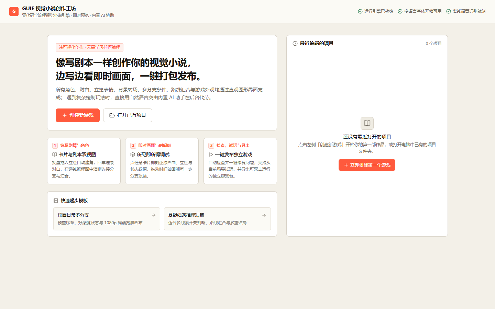
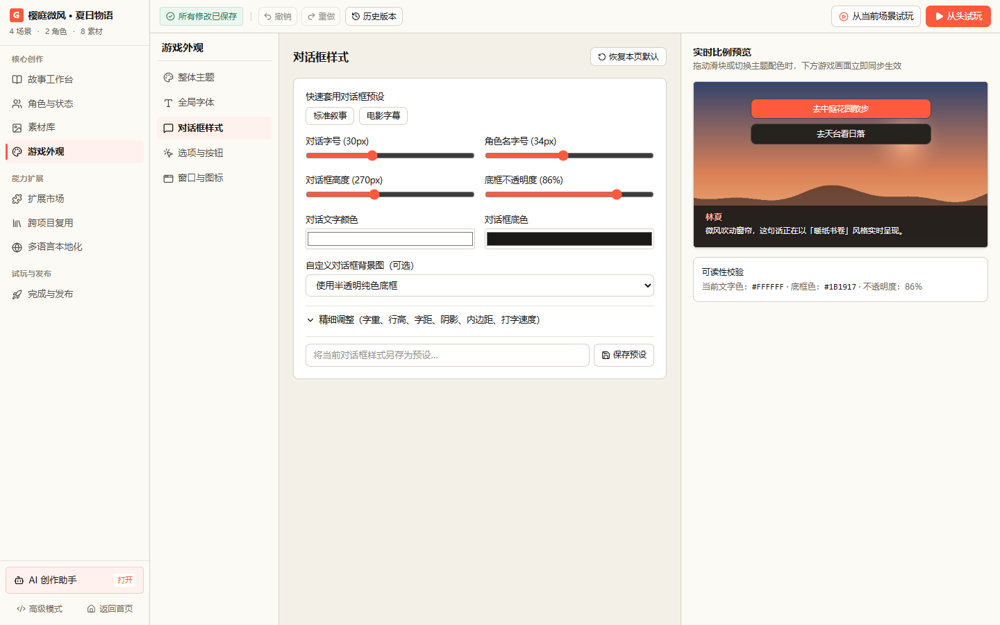

# GUIE 视觉小说创作工坊（Ren'Py 零代码可视化创作引擎）

> **纯 GUI 零代码全流程创作 + 内置 AI 全能编辑兜底 + 编辑器内即时预览与时间轴调试**

**GUIE（GUI Engine Studio）** 是一款以 **Ren'Py** 为底层运行引擎、默认面向**完全零编程基础创作者**打造的桌面视觉小说（AVG / Galgame）可视化创作工具，同时为进阶开发者保留可选的「高级模式」。

创作者无需学习任何编程语言，无需配置引擎路径、环境变量或命令行，从新建游戏、角色与剧情编排、多分支与路线汇合、即时预览调试到一键打包可双击运行的独立游戏，全程在安静、克制的「纸张工作台」图形界面内完成。

---

## 核心特色与界面一览

### 1. 编辑出版式欢迎首页 & 开箱即用多语言支持
- 零配置启动：内置运行引擎、开源多语言字体（思源黑体精简版）与离线语音识别模型，彻底杜绝中日韩文字显示缺字方框。
- 三步上手引导与最近项目列表，30 秒即可进入第一步创作。



### 2. 三栏故事工作台 · 卡片/纯文本/流程图三视图 · 即时预览与时间轴调试
- **左侧大纲**：完整章节与场景管理（折叠、排序、软停用、新建场景自动衔接防断链）。
- **中间编辑区**：卡片剧本（分段加载、跨页安全折叠、任意位置插入、回车正向连录、多行粘贴拆分、富文本可视化工具栏）、纯文本高速剧本（无损保留所有结构化事件）、选线流程图与叙事因果地图（连续剧情段节点、路线汇合、状态因果连线、点连线直改选项）。
- **右侧常驻预览**：所见即所得 16:9 即时游戏舞台（多层视差、镜头推拉震屏、色彩滤镜、雨雪樱花粒子、交互式选项）+ 可视化时间轴回溯调试器（实时改故事状态测分支）+ **真实 Ren'Py 实机画面镜像模式**。


### 3. 角色批量建角、素材引用追踪与实时外观定制
- **角色与状态**：拖入「角色名_表情名.png」批量自动建角与追加表情；故事状态（数字/开关/文字、跨周目持久）独立管理。
- **素材库**：统一拖拽自动分类、缺失/未使用筛选、打包范围预测、点击引用位置直达剧情卡片、一键全项目替换。
- **游戏外观**：主题、字体、对话框、按钮、窗口五分类导航，所有内置风格（含「明亮清爽」）均保障高可读性文字对比度，右侧实时比例预览。




### 4. 内置 AI 创作助手（结构化编辑 + 高级定制源码兜底）
- 零外部程序安装，仅需填入 API Key（预置 DeepSeek 官方配置并加密本地持久化）。
- 基础剧情生成标准可编辑卡片与流程图；复杂定制需求（如手机聊天系统、背包、小游戏）直接维护受保护扩展脚本并自动运行校验与自修复；推理过程默认折叠为单行，操作记录清晰合并，支持一键全局撤销。


### 5. 真实可玩扩展市场、离线语音转剧本与完成发布向导
- **六大系统级扩展**：CG 鉴赏/已读回想/结局收集册（真实跨周目解锁）、角色好感度进度页、六格大图存档页、玩家自定义名字、选择前自动存档、章节标题过场卡。
- **内置 100% 离线语音识别（ASR）**：支持直接录音或批量导入音频文件离线转文字，校对后一键顺序匹配现有对白或批量生成带配音对白。
- **完成向导**：自动检查与真实可用一键修复 → 从头/从当前场景试玩 → 一键导出 Windows 独立可双击运行游戏包。


---

## 创作者零基础快速上手指南

1. **创建游戏**：打开软件后点击首页「创建新游戏」，填写游戏名称和画面比例即可进入工作台。
2. **建立角色与导入素材**：进入「角色与状态」拖入立绘图片自动生成角色与表情，或在「素材库」拖入背景图、背景音乐与音效。
3. **编写对白与设计分支**：回到「故事工作台」，在卡片中直接输入对白并按 `Enter` 连续录入；点击「添加内容」插入背景、立绘、镜头粒子或「玩家选择分支」，用自然句子设置条件规则与好感度增减。
4. **边写边看与时间轴调试**：点击任意卡片即可在右侧即时画面查看效果，拖动下方时间轴或修改故事状态实时测试不同分支条件。
5. **检查、试玩与导出**：切换到「完成与发布」，点击「立即全面检查」确认无误并试玩后，点击「立即打包导出」生成独立可玩的 Windows 游戏包。

---

## 配套产品文档

- [功能介绍大纲](docs/功能介绍大纲.md)：产品定位、核心模块结构、创作工作流与明确的能力边界说明。
- [完整功能与宣传卖点目录](docs/完整功能与宣传卖点目录.md)：面向产品展示与竞品对比的完整功能与差异化卖点清单。

---

## 开发者指南（源码运行、测试与打包）

### 环境要求
- Node.js 22+
- Windows 10/11 x64（用于 Windows 独立构建与实机运行）

### 启动热更新开发模式
```bash
npm install
npm run dev
```
> 首次启动时，`scripts/prepare-runtime.mjs` 会自动校验并从 `vendor/archives/` 解压内置运行引擎、开源 CJK 字体与离线语音模型到 `vendor/runtime/`（仓库内所有归档分片均严格小于 100MB，满足 GitHub 单文件限制）。

### 运行测试与全页面自动化截图
```bash
# 单元与后端集成测试（含真实 Ren'Py Lint、离线 ASR、术语审计与 AI 闭环）
npm test

# 端到端黄金旅程验收测试（启动真实桌面程序直至导出并验证独立游戏 EXE）
npm run test:e2e

# 无需打包，直接从最新源码一键截取全部核心页面高清演示图
npm run screenshots
```

### 构建 Windows 发布产物（安装版 + 单文件便携版）
```bash
npm run dist:win
```
构建完成后，可在 `release/` 目录获得：
- **Windows 安装版（NSIS）**
- **Windows 单文件便携版（Portable EXE）**

---

## 开源许可

本项目采用 MIT License 开源；内置运行引擎组件、开源思源黑体字体及离线语音识别模型遵循其各自上游开源许可协议。
